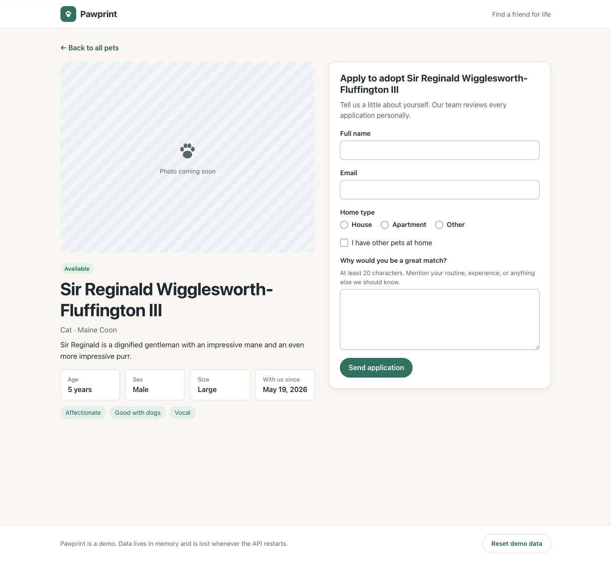

# Pawprint

A small reference application for a pet-adoption catalog: a **NestJS** API, a **React** web app,
and a **Storybook** that runs entirely on mocked requests. People can browse seeded pets, search and
filter them, open a pet's details, and submit an adoption application.

> [!WARNING]
> **All data lives in memory.** Pets are seeded on startup, and every change (new applications,
> pets moving to "pending") disappears when the API restarts. Use **Reset demo data** in the footer,
> or `POST /api/demo/reset`, to restore the seed data without restarting.


## Requirements

- **Node.js 26** (current LTS). The version is pinned in [`.nvmrc`](.nvmrc) and enforced through
  `engines` with `engine-strict`.
- **pnpm 12** (pinned in `packageManager`). Node 25+ no longer bundles Corepack, so install pnpm
  directly with `npm install -g pnpm@12`.

## Quick start

```sh
pnpm install
pnpm setup:browsers   # one-time: downloads Chromium for Storybook and browser tests
pnpm dev
```

- Web app: <http://localhost:5173>
- API: <http://localhost:3000/api>
- Swagger UI: <http://localhost:3000/docs> (also proxied at <http://localhost:5173/docs>)

## Commands

| Command                | What it does                                                                     |
| ---------------------- | -------------------------------------------------------------------------------- |
| `pnpm install`         | Installs dependencies and builds `@pawprint/contracts`                           |
| `pnpm dev`             | Starts the API (watch mode) and the Vite dev server together                     |
| `pnpm storybook`       | Starts Storybook on <http://localhost:6006>; the API does not need to be running |
| `pnpm test`            | Runs contract, API unit and e2e, Storybook, and browser tests                    |
| `pnpm test:e2e`        | Runs only the Playwright happy-path test                                         |
| `pnpm build`           | Builds contracts, the API (`apps/api/dist`), and the web app (`apps/web/dist`)   |
| `pnpm build-storybook` | Builds a static Storybook into `apps/web/storybook-static`                       |
| `pnpm lint`            | Runs ESLint, then type-checks every package                                      |
| `pnpm setup:browsers`  | Installs the Playwright Chromium build used by the tests                         |

To run the built API in production mode, which disables the reset endpoint:

```sh
pnpm build
NODE_ENV=production pnpm --filter @pawprint/api start
```

### Environment variables

| Variable   | Used by | Default                 | Purpose                                     |
| ---------- | ------- | ----------------------- | ------------------------------------------- |
| `PORT`     | API     | `3000`                  | HTTP port                                   |
| `NODE_ENV` | API     | unset                   | `production` removes `POST /api/demo/reset` |
| `API_URL`  | Web     | `http://localhost:3000` | Target of the Vite `/api` and `/docs` proxy |
| `WEB_PORT` | Web     | `5173`                  | Vite dev server port                        |

## Architecture

```text
pawprint/
├── packages/contracts   Zod schemas + inferred TypeScript types (the single source of truth)
├── apps/api             NestJS 12 (ESM): controllers → services → repository interfaces
├── apps/web             React 19 + Vite + TanStack Query + React Router; Storybook lives here
└── e2e                  One Playwright test that drives the real API and web app
```

It's a plain pnpm workspace with no Nx or Turborepo. Root scripts use `pnpm -r` and `--filter`.

### Shared contracts

`@pawprint/contracts` defines every request and response shape once, as Zod schemas, and exports
the inferred types. The same schemas are used in four places:

1. **API validation.** Nest 12 supports Standard Schema natively, so controllers declare
   `@Body({ schema: CreateAdoptionApplicationSchema })` or `@Query({ schema: PetQuerySchema })`, and a
   global `StandardSchemaValidationPipe` turns failures into `400` responses with field-level `issues`.
2. **OpenAPI.** `@nestjs/swagger` converts the same schemas (via Zod's Standard JSON Schema support)
   into `components.schemas`, so no DTO classes are duplicated. Names come from `.meta({ id })`.
3. **Web app.** The API client parses every response with the shared schema, and the adoption form
   validates with the same schema before submitting, so client and server messages match.
4. **Mocks and tests.** MSW handlers validate request bodies, and API e2e tests parse responses with
   the shared schemas.

### API (`apps/api`)

```text
src/
├── core/                    Clock and IdGenerator providers (global module)
├── pets/                    PetRepository interface, Map-backed implementation, seed data
├── adoption-applications/   AdoptionApplicationRepository interface + Map-backed implementation
├── demo/                    POST /api/demo/reset (only registered outside production)
├── health/                  GET /api/health
├── configure-app.ts         Global prefix, validation pipe, Swagger (shared by main.ts and e2e tests)
└── main.ts
```

- **Repositories** are TypeScript interfaces bound to injection tokens (`PET_REPOSITORY`, …). The
  in-memory implementations store data in a `Map`, and every read or write goes through
  `structuredClone`, so callers never hold a reference to stored state.
- **Deterministic data.** Seed pets have fixed IDs (`pet-001` … `pet-012`) and fixed intake dates.
  Application IDs come from a sequential `IdGenerator` (`app-0001`, `app-0002`, …), and timestamps come
  from an injectable `Clock`. Tests swap in `FixedClock`, so responses are fully predictable. Demo
  reset restores the seed data, clears applications, and restarts ID sequences.
- **Business rules.** The first application for an `available` pet moves it to `pending`. Applying
  for an `adopted` pet returns `409`, and an unknown pet returns `404`.
- **Demo reset gating.** `AppModule.register({ demoResetEnabled })` includes `DemoModule` only when
  `NODE_ENV !== 'production'`, so in production the route doesn't exist at all (`404`).

### Web (`apps/web`)

```text
src/
├── api/          fetch client (ApiError, schema parsing), TanStack Query hooks, QueryClient factory
├── components/   Presentational components + their stories
├── pages/        CatalogPage and PetDetailPage (data fetching) + page-level stories
├── mocks/        Fixtures and MSW handlers shared by all stories
└── styles.css    Plain CSS with custom properties; no UI framework
```

- Filters live in the URL (`/?species=cat&status=available&search=mo&sort=newest`), so filtered
  views can be shared and the back button works. Search input is debounced.
- Every view handles loading (skeletons), empty, error (with retry), validation, and success states.
- Accessibility: semantic landmarks and headings, a skip link, labelled form controls with
  `aria-invalid`/`aria-describedby`, focus moved to the first invalid field and to the confirmation
  heading, live regions for result counts and reset status, visible focus rings, and
  `prefers-reduced-motion` support.
- In development, Vite proxies `/api` and `/docs` to the Nest server, so the browser never needs CORS.



## API examples

```sh
# Health
curl http://localhost:3000/api/health
# {"status":"ok"}

# List pets: optional search (by name), species, status, and sort (name | youngest | oldest | newest)
curl 'http://localhost:3000/api/pets?species=dog&status=available&sort=youngest'
# {"items":[{"id":"pet-007","name":"Pepper","species":"dog",...}],"total":3}

# One pet
curl http://localhost:3000/api/pets/pet-001

# Unknown pet
curl http://localhost:3000/api/pets/pet-999
# {"message":"Pet \"pet-999\" was not found","error":"Not Found","statusCode":404}

# Submit an application
curl -X POST http://localhost:3000/api/adoption-applications \
  -H 'Content-Type: application/json' \
  -d '{
        "petId": "pet-001",
        "applicantName": "Jordan Rivera",
        "email": "jordan@example.com",
        "homeType": "house",
        "hasOtherPets": false,
        "message": "We have a fenced yard and love long weekend walks."
      }'
# 201 {"id":"app-0001","petName":"Biscuit","status":"received","submittedAt":"...",...}

# Validation errors are reported per field
curl -X POST http://localhost:3000/api/adoption-applications \
  -H 'Content-Type: application/json' -d '{"petId":"pet-001","applicantName":"A"}'
# 400 {"statusCode":400,"error":"Bad Request","message":"Validation failed",
#      "issues":[{"path":"applicantName","message":"Enter your full name"}, ...]}

# List applications (newest first)
curl http://localhost:3000/api/adoption-applications

# Restore seed data (not available when NODE_ENV=production)
curl -X POST http://localhost:3000/api/demo/reset
# {"pets":12,"applications":0}
```

The raw OpenAPI document is served at <http://localhost:3000/docs/openapi.json>.

> There's no authentication by design, so anyone who can reach the API can list applications,
> including applicants' email addresses. Don't deploy this as-is with real data.

## Testing strategy

| Layer                | Tooling                                        | Where                                        |
| -------------------- | ---------------------------------------------- | -------------------------------------------- |
| Contracts            | Vitest                                         | `packages/contracts/src/*.test.ts`           |
| Repositories         | Vitest                                         | `apps/api/src/**/in-memory-*.spec.ts`        |
| Services             | Vitest (constructed directly, no Nest needed)  | `apps/api/src/**/*.service.spec.ts`          |
| API end-to-end       | Vitest + `@nestjs/testing` + Supertest         | `apps/api/test/app.e2e-spec.ts`              |
| Components and pages | Storybook + `@storybook/addon-vitest` + axe    | `apps/web/src/**/*.stories.tsx`              |
| Browser happy path   | Playwright against the real API and web app    | `e2e/adoption.spec.ts`                       |

- **API unit tests** build services from the real in-memory repositories with `FixedClock` and
  `SequentialIdGenerator`, which keeps them fast and readable without mocks. They cover filtering,
  sorting, copy-on-read/write, status transitions, conflicts, and reset.
- **API e2e tests** boot the full `AppModule` (with the clock overridden) through the same
  `configureApp` used in production. They assert exact payloads, validation issues, 404/409
  handling, the OpenAPI document, and that reset is absent in production mode.
- **Storybook tests.** Every story runs in headless Chromium through Vitest. A story fails if it
  throws, if its `play` function fails, or if axe reports **any** accessibility violation
  (`parameters.a11y.test = 'error'`). Interaction tests cover filtering, opening details, client and
  server validation, conflicts, and successful submission. Requests are mocked with MSW
  (`src/mocks/handlers.ts`): defaults are installed in `.storybook/preview.tsx`, and individual
  stories override them in `beforeEach({ msw })`.
- **Browser test.** A single Playwright test resets the data, filters the catalog, opens a pet,
  triggers validation, submits an application, and checks the confirmation and the pet's new
  "pending" status. It starts its own API (port 3100) and web server (port 5180), so it can run
  while `pnpm dev` is running.

## Storybook

Run `pnpm storybook`. Stories are written in CSF Next (`preview.meta(...)` / `meta.story(...)`) and
organized as:

- **Components:** `PetCard` (available, pending, adopted, long name, missing or broken image,
  skeletons), `CatalogFilters`, `AdoptionForm` (empty, validation, submitting, server validation,
  conflict, network error), `ApplicationConfirmation`, and `DemoResetControl`.
- **Pages:** `Catalog` (default, loading, empty results, empty catalog, API error, filtering, opening
  details) and `PetDetail` (available, adopted, long name without photo, loading, not found, API
  error, form validation, successful submission, server validation error, conflict).

Use the **Interactions** and **Accessibility** panels to inspect each story, or run the whole suite
from the Storybook sidebar's test widget.
