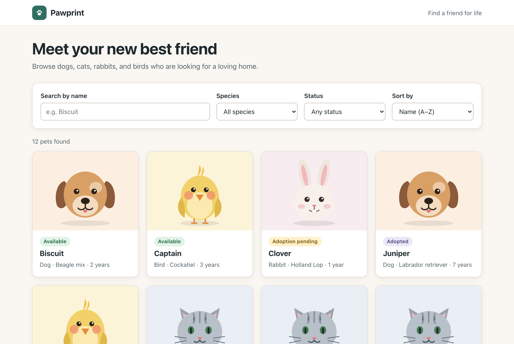
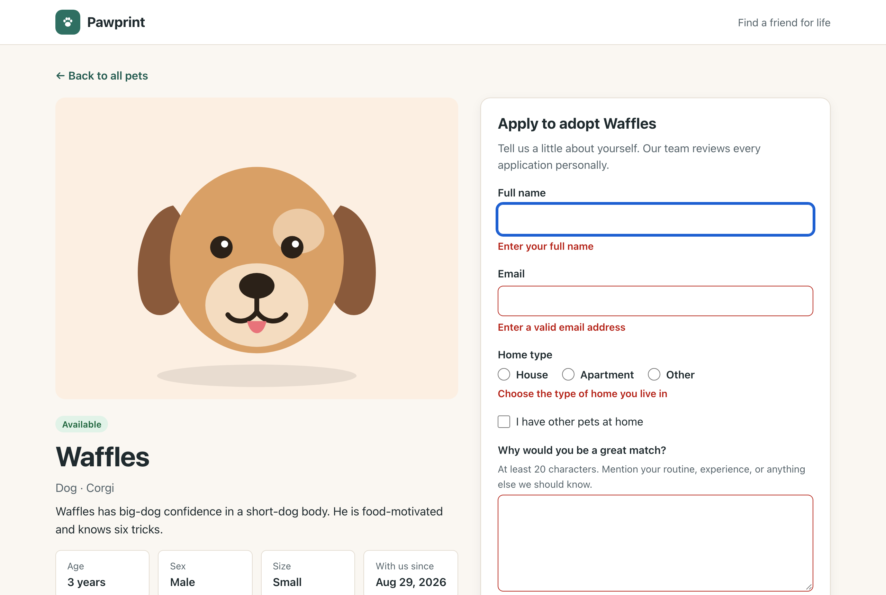
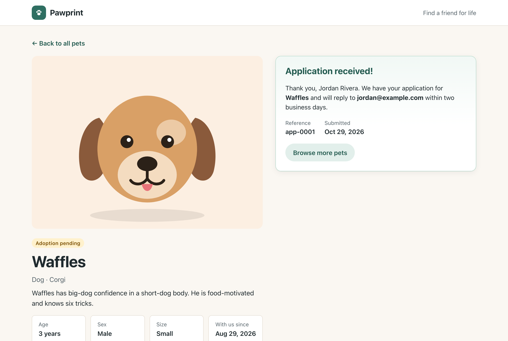
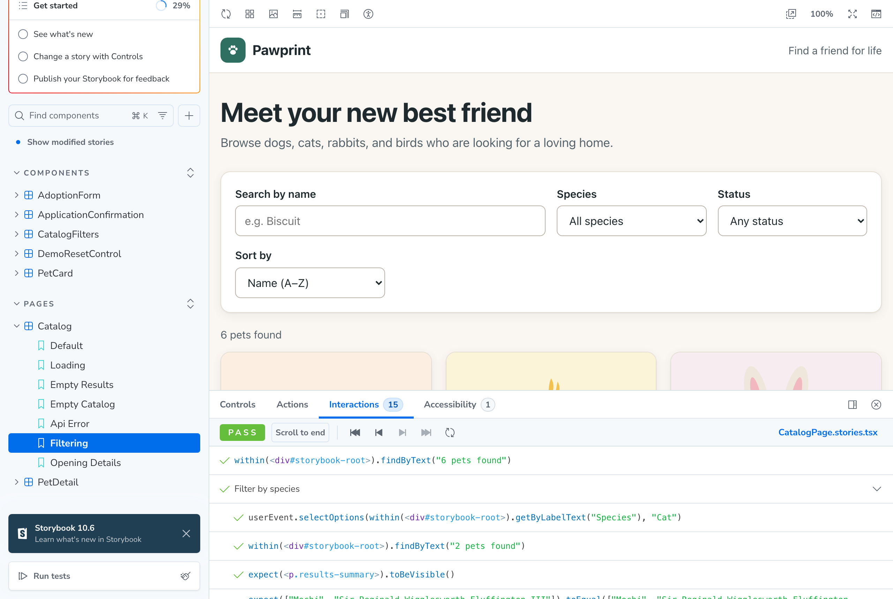
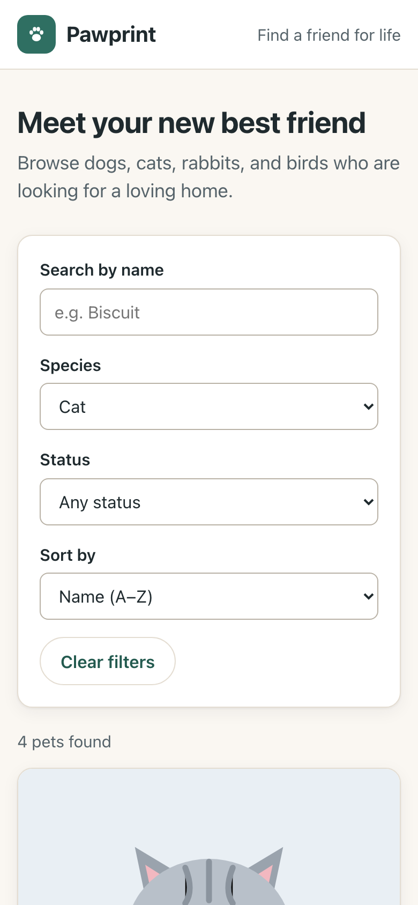
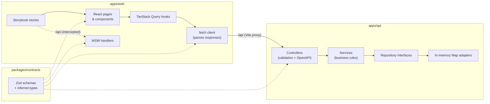

<div align="center">

# Pawprint

**A small, complete reference app for a pet-adoption catalog:<br/>NestJS API · React web app · Storybook as a test suite · one set of shared contracts.**

[](https://github.com/jtkunley/pawprint/actions/workflows/ci.yml)


[](LICENSE)



</div>

People can browse seeded pets, search by name, filter by species and adoption status, open a pet's
details, and submit an adoption application. It's deliberately small, with no auth, database, or
monorepo tooling, so the patterns stay easy to see:

- **One source of truth for API shapes.** Zod schemas in `packages/contracts` drive server
  validation, the OpenAPI document, client-side form validation, response parsing, and mock data.
  There are no hand-written DTO classes.
- **Repository interfaces with in-memory adapters.** Map-backed storage returns copies, so the
  rest of the code can't tell it apart from a real database, and swapping one in only touches a
  provider binding.
- **Deterministic by construction.** Seed IDs and dates are fixed, and the clock and ID generator
  are injectable, so tests assert exact payloads.
- **Stories are tests.** Every Storybook story renders against MSW mocks in headless Chromium and
  fails on interaction errors or on **any** axe accessibility violation.
- **Every state is designed.** Loading, empty, error, validation, success, not-found, and conflict
  states all exist and are covered by stories.

> [!WARNING]
> **All data lives in memory.** Pets are re-seeded on every start, and changes such as new
> applications or pets moving to "pending" **disappear when the API restarts**. Use **Reset demo data**
> in the footer, or `POST /api/demo/reset`, to restore the seed data without restarting.

## Contents

- [Quick start](#quick-start)
- [Commands](#commands)
- [Screenshots](#screenshots)
- [Tech stack](#tech-stack)
- [Architecture](#architecture)
- [Design decisions](#design-decisions)
- [API reference](#api-reference)
- [Testing strategy](#testing-strategy)
- [Storybook](#storybook)
- [Configuration](#configuration)
- [Extending Pawprint](#extending-pawprint)
- [Troubleshooting](#troubleshooting)

## Quick start

Prerequisites: **Node.js 26** (pinned in [`.nvmrc`](.nvmrc) and enforced via `engines`) and
**pnpm 12** (pinned in `packageManager`). Node 25+ no longer bundles Corepack, so install pnpm
directly:

```sh
npm install -g pnpm@12
```

Then:

```sh
git clone https://github.com/jtkunley/pawprint.git
cd pawprint
pnpm install
pnpm setup:browsers   # one-time: Chromium for Storybook tests and the browser test
pnpm dev
```

| What       | URL                                        |
| ---------- | ------------------------------------------ |
| Web app    | <http://localhost:5173>                    |
| API        | <http://localhost:3000/api>                |
| Swagger UI | <http://localhost:3000/docs>               |
| Storybook  | <http://localhost:6006> (`pnpm storybook`) |

## Commands

All commands run from the repository root.

| Command                | What it does                                                                   |
| ---------------------- | ------------------------------------------------------------------------------ |
| `pnpm install`         | Installs dependencies and builds `@pawprint/contracts`                         |
| `pnpm dev`             | Starts the API (watch mode) and the Vite dev server together                   |
| `pnpm storybook`       | Starts Storybook; the API does **not** need to be running                      |
| `pnpm test`            | Runs every test layer: contracts, API unit and e2e, Storybook, browser         |
| `pnpm test:e2e`        | Runs only the Playwright browser test                                          |
| `pnpm build`           | Builds contracts, the API (`apps/api/dist`), and the web app (`apps/web/dist`) |
| `pnpm build-storybook` | Builds a static Storybook into `apps/web/storybook-static`                     |
| `pnpm lint`            | Runs ESLint, Prettier (check), and type-checks every package                   |
| `pnpm format`          | Formats the repository with Prettier                                           |
| `pnpm setup:browsers`  | Installs the Playwright Chromium build used by the tests                       |

To run the production build, which removes the reset endpoint:

```sh
pnpm build
NODE_ENV=production pnpm --filter @pawprint/api start
```

## Screenshots

| Client-side validation                    | Application received                   |
| ----------------------------------------- | -------------------------------------- |
|  |  |

| Storybook: interaction test passing               | Mobile                                                         |
| ------------------------------------------------- | -------------------------------------------------------------- |
|  |  |

## Tech stack

| Area      | Choice                                                                                             |
| --------- | -------------------------------------------------------------------------------------------------- |
| Language  | TypeScript 6 (strict, `noUncheckedIndexedAccess`)                                                  |
| Workspace | pnpm workspaces; no Nx or Turborepo                                                                |
| Contracts | Zod 4 (Standard Schema + Standard JSON Schema)                                                     |
| API       | NestJS 12 (native ESM), Express, `@nestjs/swagger`                                                 |
| Web       | React 19, Vite 8, TanStack Query 5, React Router 8, plain CSS                                      |
| Storybook | Storybook 10 (CSF Next), MSW 3, `@storybook/addon-vitest`, `@storybook/addon-a11y`                 |
| Testing   | Vitest 5 (Node and browser mode), Supertest, Playwright                                            |
| Quality   | ESLint 10 (flat config, typescript-eslint, React Hooks, Storybook rules), Prettier, GitHub Actions |

## Architecture



```text
pawprint/
├── packages/contracts/   Zod schemas and inferred types shared by every package
├── apps/api/             NestJS API
│   ├── src/core/         Injectable Clock and IdGenerator (global module)
│   ├── src/pets/         PetRepository interface, Map adapter, seed data, service, controller
│   ├── src/adoption-applications/
│   ├── src/demo/         POST /api/demo/reset, only registered outside production
│   ├── src/health/
│   ├── src/configure-app.ts   Prefix, validation pipe, Swagger; shared by main.ts and e2e tests
│   └── test/             HTTP end-to-end tests
├── apps/web/             React app and Storybook
│   ├── .storybook/       Providers, MSW defaults, a11y-as-error
│   ├── src/api/          fetch client, ApiError, TanStack Query hooks
│   ├── src/components/   Presentational components (+ stories)
│   ├── src/pages/        Data-fetching pages (+ page-level stories)
│   └── src/mocks/        Fixtures and MSW handlers used by stories
├── e2e/                  Playwright happy-path test across the real API and web app
└── docs/                 Screenshots
```

### Request lifecycle

Here's what happens when someone submits an application:

1. `AdoptionForm` validates its values with `CreateAdoptionApplicationSchema`. Errors render inline
   with `aria-invalid`/`aria-describedby`, and focus moves to the first invalid field.
2. `useSubmitApplication` (TanStack Query) calls `api.submitApplication`, which `POST`s JSON and
   parses the `201` body with `AdoptionApplicationSchema`.
3. In Nest, `@Body({ schema: CreateAdoptionApplicationSchema })` runs through the global
   `StandardSchemaValidationPipe`. Failures become `400 { message, issues: [{ path, message }] }`,
   which the form maps back onto its fields.
4. `AdoptionApplicationsService` checks the pet (`404` if unknown, `409` if adopted), stamps an ID
   from `IdGenerator` and a time from `Clock`, saves the application, and moves an `available` pet
   to `pending`.
5. On success the client invalidates pet queries, so the badge updates, and the form is replaced by
   a confirmation that receives focus.

## Design decisions

<details>
<summary><strong>Zod contracts instead of DTO classes</strong></summary>

Nest 12 accepts any [Standard Schema](https://standardschema.dev) in `@Body`, `@Query`, and
`@Param`, and `@nestjs/swagger` converts schemas that implement Standard JSON Schema (Zod 4 does)
into OpenAPI components. Naming a schema with `.meta({ id: 'Pet' })` turns it into
`#/components/schemas/Pet`. One definition therefore covers runtime validation, static types, API
docs, client parsing, and mock validation, so there's nothing to drift.
</details>

<details>
<summary><strong>Repository interfaces with copy-on-read/write</strong></summary>

Services depend on `PetRepository` and `AdoptionApplicationRepository` through injection tokens.
The in-memory adapters `structuredClone` on every read and write, so code can't accidentally
mutate stored state, which is the same guarantee a real database gives. Filtering and sorting live
in the repository because a database would do them in the query.
</details>

<details>
<summary><strong>Determinism</strong></summary>

Seed pets have fixed IDs (`pet-001` … `pet-012`) and dates. Application IDs come from a sequential
`IdGenerator` (`app-0001`, …) and timestamps from an injectable `Clock`. Tests use `FixedClock`, so
e2e tests compare whole response bodies. Demo reset also restarts the ID sequence.
</details>

<details>
<summary><strong>Demo reset only outside production</strong></summary>

`AppModule.register({ demoResetEnabled })` only imports `DemoModule` when
`NODE_ENV !== 'production'`. In production the route doesn't exist (`404`) rather than being
guarded at runtime, and an e2e test asserts this.
</details>

<details>
<summary><strong>Filters in the URL</strong></summary>

Search, species, status, and sort live in query parameters, e.g.
`/?species=cat&status=available&search=mo`. Filtered views can be bookmarked and shared, the back
button works, and invalid values are ignored. Typed search is debounced, and
`placeholderData: keepPreviousData` keeps results on screen while refetching.
</details>

<details>
<summary><strong>Storybook as the component test suite</strong></summary>

`@storybook/addon-vitest` turns every story into a Vitest browser test. `parameters.a11y.test =
'error'` makes any axe violation fail the build. Page stories render the real `AppRoutes` inside a
`MemoryRouter`, so interaction tests can navigate from the catalog into a pet's details. MSW
handlers are installed per story with `beforeEach({ msw })`, which is why Storybook never needs
the API.
</details>

<details>
<summary><strong>What's intentionally missing</strong></summary>

There's no authentication, persistence, pagination, image upload, or admin workflow. Those are
real concerns, but each would add more code than insight to a reference of this size.
</details>

## API reference

Interactive docs are at **<http://localhost:3000/docs>**, and the raw OpenAPI document is at
`/docs/openapi.json`. Errors always have the shape
`{ statusCode, error, message, issues? }`.

| Method | Path                         | Description                                                   |
| ------ | ---------------------------- | ------------------------------------------------------------- |
| `GET`  | `/api/pets`                  | List pets. Query: `search`, `species`, `status`, `sort`       |
| `GET`  | `/api/pets/:id`              | One pet, or `404`                                             |
| `POST` | `/api/adoption-applications` | Submit an application: `201`, `400` (issues), `404`, or `409` |
| `GET`  | `/api/adoption-applications` | List applications, newest first                               |
| `POST` | `/api/demo/reset`            | Restore seed data (**not registered in production**)          |
| `GET`  | `/api/health`                | Liveness check                                                |

`species`: `dog | cat | rabbit | bird` · `status`: `available | pending | adopted` ·
`sort`: `name` (default) `| youngest | oldest | newest`

```sh
curl 'http://localhost:3000/api/pets?species=dog&status=available&sort=youngest'
# {"items":[{"id":"pet-007","name":"Pepper","species":"dog",...}],"total":3}

curl http://localhost:3000/api/pets/pet-999
# 404 {"message":"Pet \"pet-999\" was not found","error":"Not Found","statusCode":404}

curl -X POST http://localhost:3000/api/adoption-applications \
  -H 'Content-Type: application/json' \
  -d '{
        "petId": "pet-001",
        "applicantName": "Jordan Rivera",
        "email": "jordan@example.com",
        "homeType": "house",
        "hasOtherPets": false,
        "message": "We have a fenced yard and love long weekend walks."
      }'
# 201 {"id":"app-0001","petName":"Biscuit","status":"received","submittedAt":"…",…}

curl -X POST http://localhost:3000/api/adoption-applications \
  -H 'Content-Type: application/json' -d '{"petId":"pet-001","applicantName":"A"}'
# 400 {"statusCode":400,"error":"Bad Request","message":"Validation failed",
#      "issues":[{"path":"applicantName","message":"Enter your full name"}, …]}

curl -X POST http://localhost:3000/api/demo/reset
# {"pets":12,"applications":0}
```

> [!CAUTION]
> There's no authentication by design, so `GET /api/adoption-applications` returns applicants'
> names and email addresses to anyone. Don't deploy this as-is with real data.

## Testing strategy

`pnpm test` runs all of the layers below, and CI runs them on every push and pull request.

| Layer              | Tooling                                     | Location                           | Tests |
| ------------------ | ------------------------------------------- | ---------------------------------- | ----: |
| Contracts          | Vitest                                      | `packages/contracts/src/*.test.ts` |     3 |
| API units          | Vitest + SWC (decorator metadata)           | `apps/api/src/**/*.spec.ts`        |    25 |
| API end-to-end     | Vitest + `@nestjs/testing` + Supertest      | `apps/api/test/app.e2e-spec.ts`    |    13 |
| Stories            | Storybook + Vitest browser mode + axe       | `apps/web/src/**/*.stories.tsx`    |    38 |
| Browser happy path | Playwright against the real API and web app | `e2e/adoption.spec.ts`             |     1 |

- **API unit tests** construct services from the real in-memory repositories plus `FixedClock`
  and `SequentialIdGenerator`, without mocks or a Nest container. They cover filtering, sorting,
  copy semantics, status transitions, conflicts, and reset.
- **API e2e tests** boot the full `AppModule` through the same `configureApp` used in production,
  overriding only the clock. They assert exact bodies, validation issues, `404`/`409`, the OpenAPI
  document, and that reset is absent in production mode.
- **Story tests** fail if a story throws, if its `play` function fails, or if axe finds any
  violation. Interaction tests cover filtering, opening details, client and server validation,
  conflicts, and successful submission.
- **The browser test** resets data, filters the catalog, opens a pet, triggers validation, submits,
  and checks the confirmation and the pet's new "pending" status. It starts its own servers on
  ports 3100 and 5180, so it runs fine alongside `pnpm dev`.

## Storybook

```sh
pnpm storybook
```

Stories are written in CSF Next (`preview.meta(...)` / `meta.story(...)`). Defaults for every
`/api` route live in [`src/mocks/handlers.ts`](apps/web/src/mocks/handlers.ts), and stories
override them per scenario:

```tsx
export const ApiError = meta.story({
  beforeEach({ msw }) {
    msw.use(petHandlers.error());
  },
  play: async ({ canvas }) => {
    await expect(await canvas.findByRole('alert')).toHaveTextContent('We couldn’t load the pets');
  },
});
```

| Group      | Stories                                                                                                                                         |
| ---------- | ----------------------------------------------------------------------------------------------------------------------------------------------- |
| PetCard    | Available, Pending, Adopted, Long name + missing image, Broken image URL, Skeleton, Grid skeleton                                               |
| Filters    | Default, Active filters, Changing filters (interaction)                                                                                         |
| Form       | Empty, Validation errors, Valid submission, Submitting, Server validation error, Already adopted, Network error, Long pet name                  |
| Other      | Application confirmation, Demo reset (success and disabled)                                                                                     |
| Catalog    | Default, Loading, Empty results, Empty catalog, API error, Filtering, Opening details                                                           |
| Pet detail | Available, Long name without photo, Adopted, Loading, Not found, API error, Form validation, Successful submission, Server validation, Conflict |

## Configuration

| Variable   | Used by | Default                 | Purpose                                     |
| ---------- | ------- | ----------------------- | ------------------------------------------- |
| `PORT`     | API     | `3000`                  | HTTP port                                   |
| `NODE_ENV` | API     | unset                   | `production` removes `POST /api/demo/reset` |
| `API_URL`  | Web     | `http://localhost:3000` | Target of the Vite `/api` and `/docs` proxy |
| `WEB_PORT` | Web     | `5173`                  | Vite dev server port                        |

## Extending Pawprint

- **Use a real database.** Implement `PetRepository` and `AdoptionApplicationRepository`, then
  change the `useFactory`/`useClass` bindings in `pets.module.ts` and
  `adoption-applications.module.ts`. Services and tests against the interfaces stay unchanged.
- **Add a field.** Add it to the Zod schema in `packages/contracts`. TypeScript then points to
  every seed, fixture, and component that needs updating, and the OpenAPI document picks it up
  automatically.
- **Add an endpoint.** Add a schema with `.meta({ id })`, pass it to `@Body`/`@Query`, and describe
  responses with `@ApiOkResponse({ standardSchema })`.

## Troubleshooting

| Symptom                                                              | Fix                                                                                    |
| -------------------------------------------------------------------- | -------------------------------------------------------------------------------------- |
| `Executable doesn't exist … chromium` in Storybook or e2e tests      | Run `pnpm setup:browsers`                                                              |
| `Unsupported engine` on install                                      | Use Node 26 (`nvm use` / `fnm use` reads `.nvmrc`)                                     |
| `pnpm: command not found`                                            | `npm install -g pnpm@12` (Node 25+ doesn't ship Corepack)                              |
| `Port 5173 is already in use`                                        | Stop the other dev server, or set `WEB_PORT`                                           |
| Web app shows "We couldn’t load the pets"                            | The API isn't running; start everything with `pnpm dev`                                |
| Interaction tests fail only in an embedded or background browser tab | Simulated typing needs a focused window. Use a regular browser tab, or run `pnpm test` |

## License

[MIT](LICENSE)
